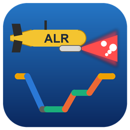

# ALR UVP6 Processing

Creates the UVPapp sample file of a UVP6 deployed on an Autosub Long Range (ALR) vehicle, from
the ALR CTD and navigation files: the deployment is cut into phases (downcasts, upcasts,
transects, surface transects, transitions), and each phase becomes one sample. It has been tested
only with data from the ALR platform.

- **Protocol**: to be published in the [Ocean Best Practices System](https://repository.oceanbestpractices.org) (DOI to come).
- **Demo data**: [ALR4_demo.zip](https://github.com/amandaelineau-stack/ALR_UVP_Processing/releases/download/ALR4_demo/ALR4_demo.zip)
  (233 MB): ALR CTD and NAV files and a complete UVP6 project.
- **Details** (settings, outputs, quality-control figures): [docs/details.md](docs/details.md).

## Install (once, Windows)

1. **Code**: green **Code** button at the top of this page → **Download ZIP**, and extract it,
   e.g. to `C:\ALR\ALR_UVP_Processing`.
2. **Demo data** (optional): extract `ALR4_demo.zip` to a short path, e.g. `C:\ALR\ALR4_demo`.
   Windows cannot write files whose path is longer than 260 characters (the app warns you).
3. **Miniconda** (free, it installs Python): [anaconda.com/download](https://www.anaconda.com/download/success),
   default options ("Just Me", keep **Create shortcuts**).
4. **Environment**: open **Anaconda Prompt** from the Start menu and type:
   ```
   cd C:\ALR\ALR_UVP_Processing
   conda env create -f environment.yml
   ```
5. **Desktop shortcut** (optional): double-click [`create_shortcut.bat`](create_shortcut.bat).

## Run with the app

Double-click the **ALR-UVP6 app** shortcut, or [`start_app.bat`](start_app.bat). A black window
opens (keep it open while you use the app), then the app opens in your web browser at
http://localhost:8501. It runs on your computer, on your data: nothing is sent anywhere.

1. **Data**: click **Browse…** and choose the deployment folder, e.g. `C:\ALR\ALR4_demo`. Its
   folders are found and checked: each title must turn green.
2. **Settings**: check the ALR serial number, the cruise and the sample integration.
3. **Run**: click **Run the pipeline**.
4. **Results**: download the sample file, and look at the checks and the figures.

To share the app, share this repository: each user installs it and runs it on their own computer.
If the black window shows "python is not recognized", type in Anaconda Prompt:
`conda activate alr_uvp`, `cd C:\ALR\ALR_UVP_Processing`, then `python -m streamlit run app.py`.

## Run with the script

Open [`run_UVP_toolbox.py`](run_UVP_toolbox.py) in VS Code (Python and Jupyter extensions,
`alr_uvp` interpreter), set `ALR_SERIAL_NUMBER`, `CRUISE` and the other settings at the top, and
click **Run Cell** above each `# %%`, in order:

| Cell | Asks for | What happens |
| --- | --- | --- |
| 1. Load and parse the ALR data (CTD and NAV) | CTD, NAV and figures folders | Reads and merges the CTD and NAV files. |
| 2. Identify the ALR phases | – | Detects the phases, saves two figures, prints the phase checks. |
| 3. Generate one netCDF file per ALR phase | UVP6 project folder | Checks the project folders, writes one netCDF per phase. |
| 4. Generate the UVPapp sample file | Yes/No if a sample file exists | Matches the UVP6 images to the phases, writes the sample file, the CTD files and the figures. |

Close UVPapp before running cell 4.

## Data and outputs

```
<deployment folder>/                         e.g. ALR4_demo
├── ALR004_ctd_data/*.log                    ALR CTD files
├── ALR004_nav_data/*.csv                    ALR navigation files
├── diagnostic_figures/                      figures and quality checks (written)
└── uvp6_<sn>_<date>_<cruise>_<platform>/    complete UVPapp project, sequences merged in UVPapp
    ├── raw/<yyyymmdd-HHMMSS>/               UVP6 sequence (read)
    ├── meta/alr_meta_sn004/*.nc             one netCDF per ALR phase (written)
    ├── meta/uvp6_header_<project>.txt       UVPapp sample file (written)
    └── CTDdata/*.ctd                        one CTD file per sample (written)
```

Files of a previous run are moved to `archives/` folders, not overwritten.
